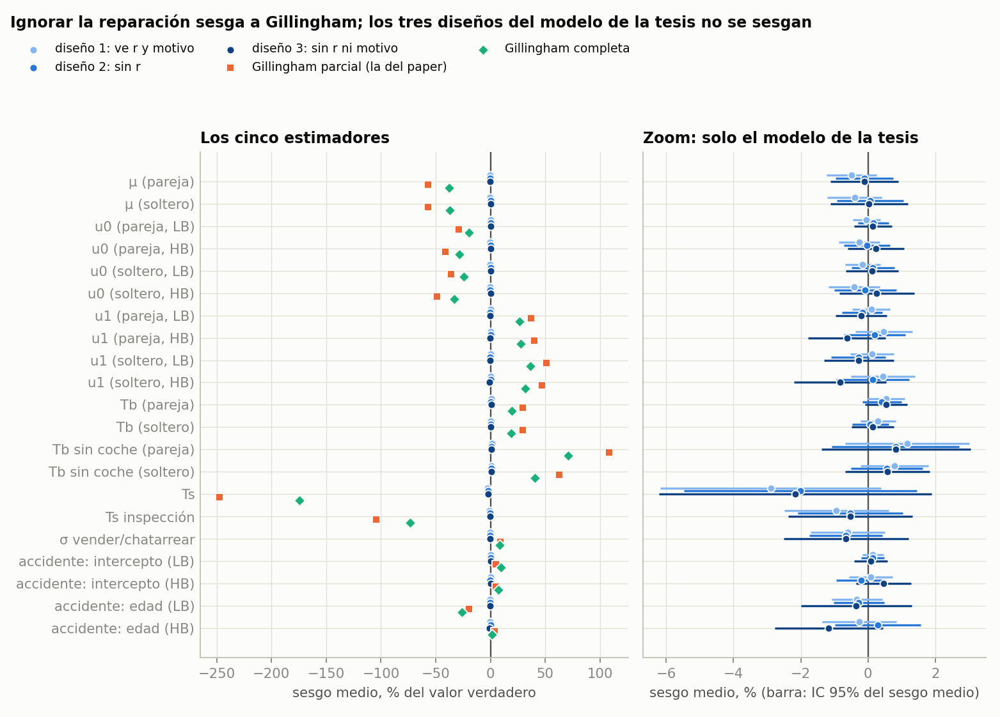
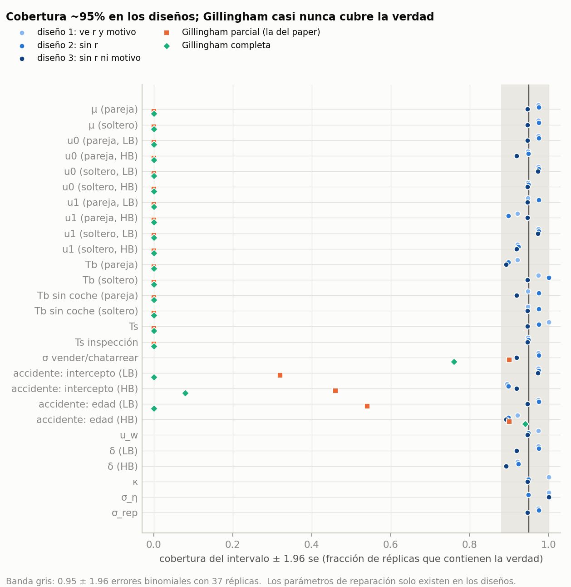
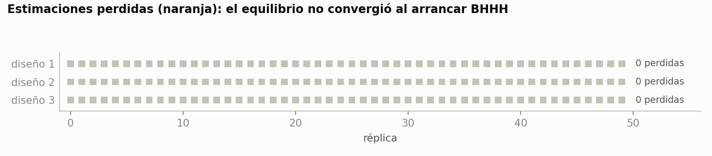
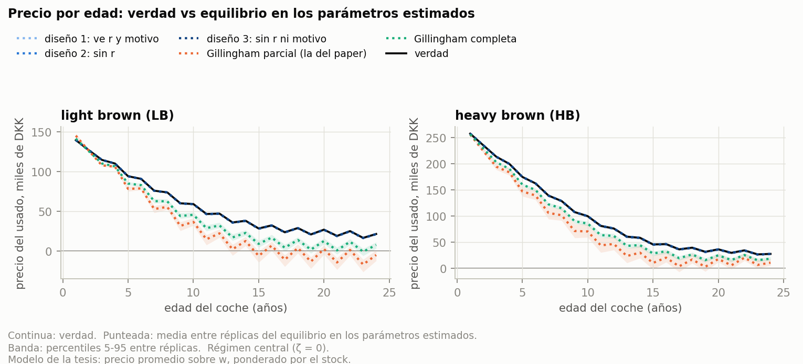
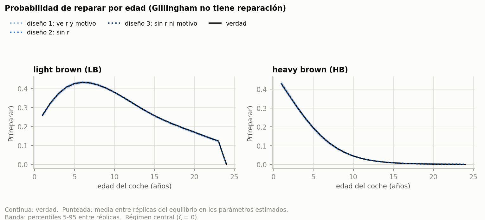
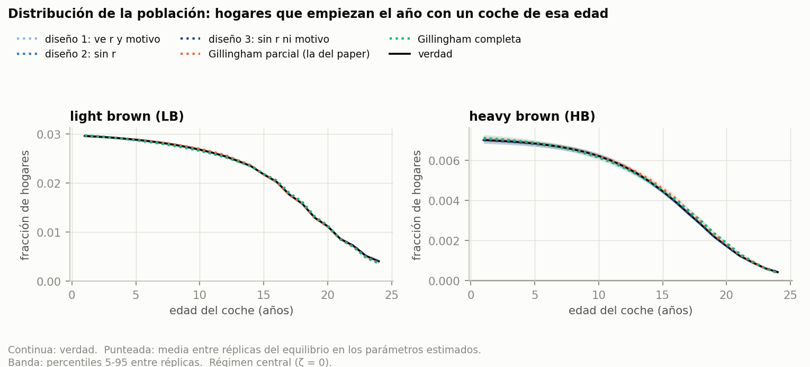
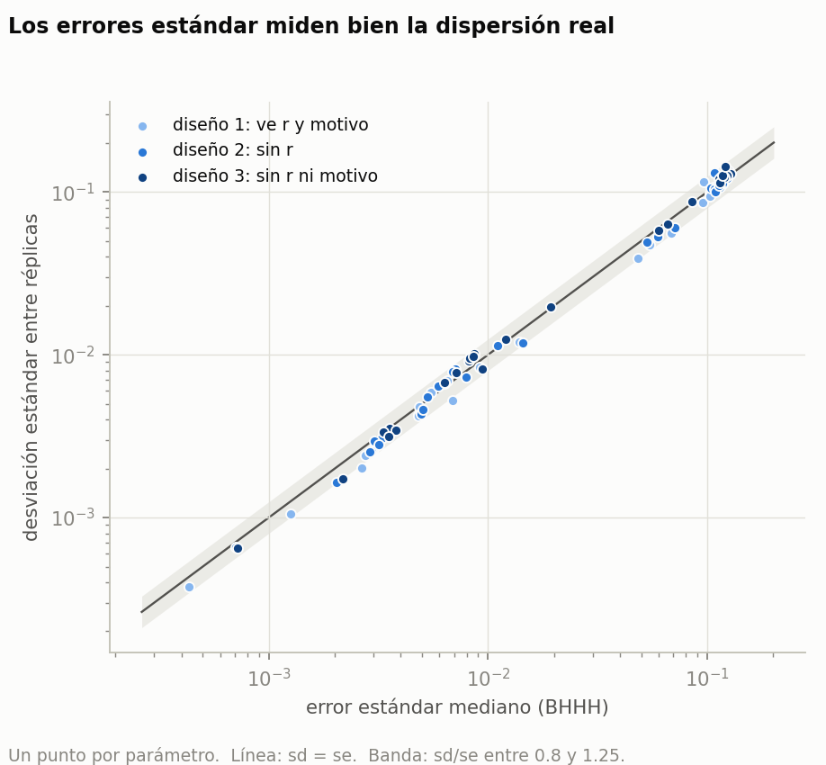
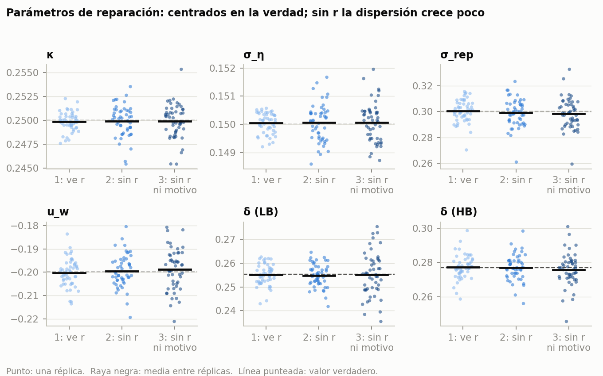

# Reporte: Monte Carlo completo (2026-10-08)

50 réplicas (0-49) del diseño de `modelo_fin.md`: 10,000 hogares por régimen, 4 años, 3
regímenes de R (90,000 transiciones por réplica). Corrido en la workstation: corrida base
(commit 691c378) + re-estimación de las 36 estimaciones perdidas con `--solo_faltantes`
(commit 6382556). **Ahora las 150 estimaciones de los diseños y las 100 de Gillingham están
completas.**

- Datos: `claude/niu/output/modelo_tesis/montecarlo/base/`.
- Gráficas y tablas: `claude/niu/output/modelo_tesis/reportes/mc_base/` (`analisis/reporte_mc.py`,
  solo lee CSV; corre en local).
- Réplica 0 en detalle: `reporte_rep0.md`.

## Hallazgos

### 1. El modelo de la tesis no se sesga, en ninguno de los tres diseños

50 réplicas por diseño.

- Sesgo medio < 1.5% del valor verdadero en todos los parámetros salvo Ts (−1.5, −2.4 y
  −2.9% en los diseños 1, 2, 3; t del sesgo −1.0 a −1.7, no significativo).
- Único |t| > 2: Tb (pareja), +0.5-0.6% en los diseños 2 y 3 (t = 2.1 y 2.3; 1.7 en el
  diseño 1). Con 27 parámetros × 3 diseños se esperan algunos |t| > 2 por azar, pero sale
  con el mismo signo en los tres diseños (son los mismos paneles, no son independientes).
  En magnitud es despreciable frente al +19-30% de Gillingham; probablemente sesgo de
  muestra finita del MLE.
- Cobertura del IC 95% entre 0.90 y 1.00 (banda binomial con 50 réplicas: ~0.88-1.00).
- sd entre réplicas / se mediano entre 0.78 y 1.21: los errores estándar BHHH están bien.
- Los parámetros de reparación (κ, σ_η, σ_rep, u_w, δ) se recuperan sin sesgo aun en el
  diseño 3 (sin r ni motivo de salida); no ver r agranda la dispersión, sobre todo la de δ.
- La tasa de reparación implícita sale 0.276, igual a la verdadera.
- Perder información cuesta poco: del diseño 1 al 3 el sesgo de los parámetros comunes
  sube algo (μ −0.1% → −0.5%) y la cobertura baja un poco, sin salir de la banda.

### 2. Gillingham sobre los mismos datos está muy sesgado

| | parcial (la del paper) | completa |
|---|---|---|
| μ | −57% | −38% |
| u0 | −29 a −49% | −20 a −33% |
| u1 | +37 a +51% | +26 a +36% |
| Tb | +29% | +19% |
| Tb sin coche | +62 a +108% | +41 a +71% |
| Ts | −248% | −174% |
| Ts inspección | −104% | −73% |
| cobertura | 0 en los 16 parámetros de preferencias y costos | 0 |

Con μ (utilidad marginal del dinero) 40-57% más baja, todo lo que Gillingham expresa en
dinero (u/μ, costos de transacción, disposición a pagar) sale inflado.

### 3. Las 36 estimaciones perdidas ya se recuperaron (y no cambian nada)

En la corrida base se perdieron 36/150 estimaciones (12, 11, 13 en los diseños 1-3), todas
con "el equilibrio no converge en el valor inicial de BHHH": BHHH arrancaba desde el
último punto de prueba de L-BFGS, no desde el mejor. Se arregló en `ll_estim.py`
(BHHH arranca en la mejor evaluación, `restore_best`, con rescates desde el mejor y desde
cero) y se re-estimaron con `montecarlo.py --solo_faltantes` (mismo panel, misma semilla).

Resultado de la re-estimación (logs `modelo_tesis/mc_faltantes_*.log`):
- 36/36 convergen (criterio de BHHH g'B⁻¹g/N < 1e-9). Ningún rescate hizo falta
  (`rescate_mejor = rescate_frio = 0`): bastó arrancar BHHH en el mejor punto.
- Todas tienen el mismo patrón: **2 evaluaciones fallidas y ~8 evaluaciones en total**
  (vs ~200 en las demás). Es decir, en estas réplicas el primer paso de L-BFGS cae en un
  θ donde el equilibrio no converge desde la cuerda, L-BFGS se rinde tras dos intentos
  (devolvemos 1e10 con gradiente cero) y quien estima es BHHH solo, desde el valor
  verdadero. Eso es lo que antes tiraba la estimación: el estado guardado era el del
  punto fallido. Como BHHH llega al mismo criterio de convergencia, la estimación es
  válida; solo cambia el camino.
- **No hay selección.** La preocupación del reporte anterior era que las réplicas perdidas
  no fueran al azar (en ellas Gillingham daba μ y u0 0.5-0.7 sd más bajos). Con los
  diseños ya estimados, el estadístico z = (θ̂ − θ)/se de las 36 recuperadas vs las 114
  originales: media +0.03 vs −0.01, sd 0.96 vs 0.98 (todos los parámetros); para μ,
  −0.18 vs −0.09 (72 vs 228 obs.). Sin diferencia relevante. Los números de las secciones
  1-2 (que ya incluyen todo) casi no se movieron respecto a la versión con 114
  estimaciones.

Pendiente menor (no urgente): el primer paso de L-BFGS es demasiado largo en ~1/4 de los
paneles. Si se quiere que L-BFGS haga su trabajo, acotar el paso inicial (p. ej. escalar
el objetivo o usar `maxls`/un primer paso de BHHH). Para el MC no hace falta.

### 4. Perfiles por edad: precios, reparación y población

El MC guardó los θ̂ pero no los equilibrios. `modelo_tesis/por_edad_mc.py` (workstation,
4.5 min en GPU; commit 76588d9) resolvió el equilibrio en cada θ̂: 150 de los diseños y
100 de Gillingham, ninguno falló. Las figuras tienen un panel por marca y usan el régimen
central (ζ = 0). Línea continua: verdad. Punteada: media entre réplicas. Banda: percentiles
5-95. El precio del modelo de la tesis es el promedio sobre w ponderado por el stock.

| | precio, edad 1-5 | edad 6-12 | edad 13-24 | q, máx. desviación | Pr(reparar), máx. desviación |
|---|---|---|---|---|---|
| diseño 1 | −0.0% | −0.0% | −0.3% | 0.7% | 0.0008 |
| diseño 2 | −0.0% | −0.1% | −0.5% | 0.7% | 0.0005 |
| diseño 3 | −0.0% | −0.2% | −0.7% | 1.5% | 0.0010 |
| Gillingham parcial | −6% | −35% | −94% | 10% | — |
| Gillingham completa | −4% | −19% | −52% | 11% | — |

(Desviación de la media entre réplicas respecto a la verdad, promediada sobre marcas y
edades del tramo; q y Pr(reparar): máximo sobre (marca, edad).)

**Precios.** Los tres diseños reproducen la curva de precios verdadera: las líneas
punteadas quedan encima de la continua. Gillingham subestima los precios de los usados y
el error crece con la edad. Con la verosimilitud parcial, el precio de LB se vuelve
negativo desde ~15 años en la mayoría de las réplicas (mínimo −33 mil DKK). El dueño
tendría que pagar por deshacerse del coche. Es la contraparte en precios del sesgo de
parámetros: μ más baja y Ts mucho más negativo (sección 2).

**Reparación.** La Pr(reparar) por edad se recupera prácticamente exacta en los tres
diseños (error máximo 0.001), incluso en el diseño 3. Se ven la joroba de LB (máximo
~0.43 a los 6 años, que viene del precio de reparación R(LB, a)) y la caída monótona de HB.

**Población.** La distribución por edad q(j, a) sí la ajusta Gillingham (error máximo ~10%,
en las edades donde hay pocos coches). Es la parte del equilibrio que la verosimilitud
"ve" directamente: las tenencias y las transacciones. Es decir, Gillingham reproduce las
cantidades, pero sus precios implícitos están muy sesgados, y los precios no entran en su
estimación. Validarlo con los precios observados (si los hay en los datos) lo delataría.

Los dientes de sierra en los precios (en la verdad y en Gillingham) alternan año con año
desde la edad 4 (p. ej. LB: 35.8 a los 13 años, 37.9 a los 14). Probablemente vienen de la
inspección cada dos años (Ts inspección, `inspect_age_min = 4`), que encarece vender en
años alternos. No lo verifiqué más a fondo.

### 5. Costo

~130 s y ~200 evaluaciones por estimación en GPU (las 36 re-estimadas: ~160 s y ~8
evaluaciones, más refactorizaciones porque la cuerda da pasos largos). Re-estimar las 36
tomó ~0.9 h en dos GPUs. Gillingham ~85-105 s por estimación en CPU (compitiendo por CPU con
la corrida de los diseños).

